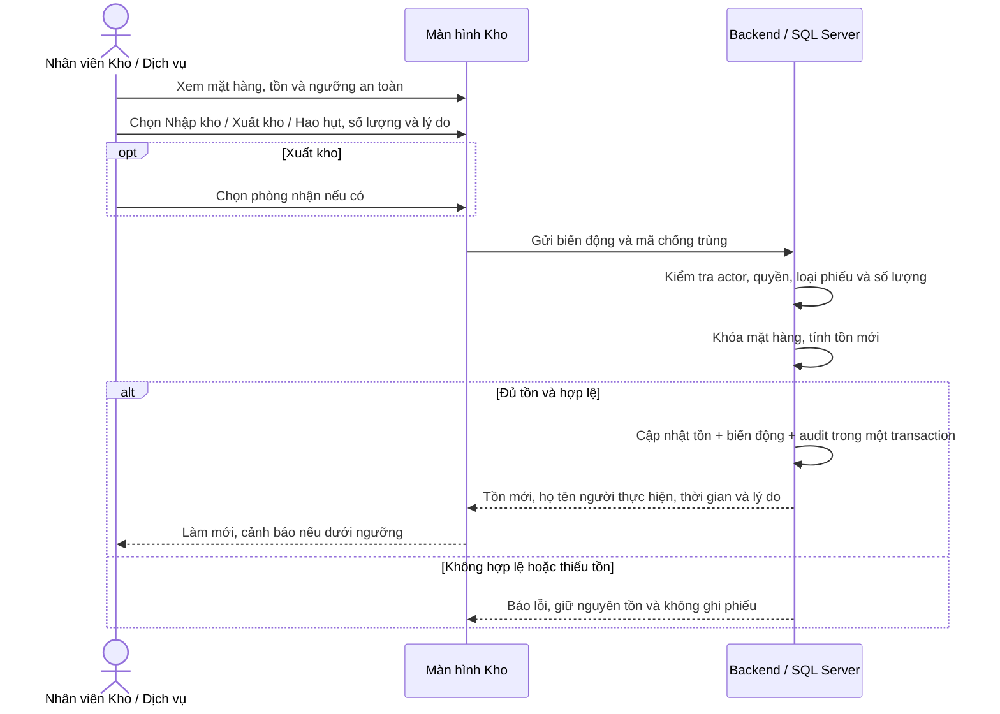

# Đối chiếu luồng Kho và Dịch vụ

Các sơ đồ dưới đây phản ánh luồng sau khi chỉnh sửa ngày 15/10/2026.

## SQ12 — Đề nghị, duyệt và áp dụng giá

```mermaid
sequenceDiagram
    actor NV as Nhân viên Kho / Dịch vụ
    participant UI as Màn hình Đề xuất
    participant BE as Backend / SQL Server
    actor QL as Quản lý / Giám đốc
    NV->>UI: Chọn dịch vụ hoặc mặt hàng, nhập giá mới và lý do
    UI->>BE: Gửi đề nghị với mã chống trùng
    BE->>BE: Kiểm tra quyền, dữ liệu, lưu PENDING và audit
    BE-->>UI: Xác nhận gửi hoặc báo lỗi cụ thể
    QL->>BE: Mở danh sách chờ duyệt
    BE-->>QL: Dịch vụ, giá hiện tại/đề nghị, người gửi, lý do, hạn xử lý
    QL->>BE: Phê duyệt hoặc từ chối
    BE->>BE: Kiểm tra quyền, trạng thái, hạn và không tự duyệt
    BE-->>QL: APPROVED hoặc REJECTED, ghi người quyết định
    opt Đã duyệt và chưa áp dụng
        QL->>BE: Người duyệt bấm Áp dụng giá ngay
        BE->>BE: Kiểm tra approval, cập nhật giá và lịch sử trong transaction
        alt Thành công
            BE-->>QL: CONSUMED / Đã áp dụng
        else Áp dụng lỗi
            BE-->>QL: Báo lỗi; giữ APPROVED để thử lại
        end
    end
```

Phê duyệt không tự đổi giá. Chỉ người đã duyệt mới được áp dụng đề nghị đó.
Thêm danh mục mới dùng luồng đề xuất riêng; danh mục chỉ hoạt động sau khi duyệt.

## SQ15 — Nhập, xuất và hao hụt



Giao diện không còn thao tác hoặc tab Điều chỉnh. Dữ liệu điều chỉnh cũ vẫn xuất hiện
trong Tất cả để giữ lịch sử. Trả kho đi theo luồng Buồng phòng gửi yêu cầu → nhân viên
Kho kiểm đếm và duyệt → mới cộng tồn; không cộng tồn lúc gửi yêu cầu.

## Đặt và sử dụng dịch vụ

```mermaid
sequenceDiagram
    actor KH as Khách hàng
    participant UI as Cổng dịch vụ
    participant BE as Backend / SQL Server
    actor NV as Nhân viên điều phối
    KH->>UI: Chọn dịch vụ, thời điểm, số lượng và phòng
    UI->>BE: Đặt dịch vụ với mã chống trùng
    BE->>BE: Kiểm tra chủ booking, cọc, thời gian, dịch vụ và hạn mức miễn phí
    BE->>BE: Khóa công suất trong transaction, kiểm tra lượng đã giữ chỗ
    alt Còn chỗ
        BE->>BE: Lưu CONFIRMED và audit
        BE-->>KH: Đã đặt
    else Hết chỗ hoặc thông tin không hợp lệ
        BE-->>KH: Báo lỗi; không tạo lượt đặt
    end
    NV->>BE: Xem lịch tất cả nhóm dịch vụ theo ngày
    BE-->>NV: Lịch đặt để lọc nhóm, tìm phòng / mã booking
    NV->>BE: Xác nhận sử dụng
    BE->>BE: Kiểm tra CHECKED_IN, đến giờ, CONFIRMED và còn tồn
    alt Đủ điều kiện
        opt Dịch vụ tiêu hao
            BE->>BE: Trừ kho và ghi phiếu xuất một lần
        end
        BE->>BE: Ghi USED và audit; tài nguyên giữ nguyên tồn
        BE-->>NV: Đã sử dụng
    else Chưa đủ điều kiện
        BE-->>NV: Báo lý do; giữ nguyên trạng thái và tồn
    end
    Note over BE: Checkout chỉ tính phí lượt USED, phần miễn phí bằng 0.<br/>Hủy / không đến / checkout hủy lượt chưa dùng.
```

Trạng thái giao diện: **Đã đặt — Đã sử dụng — Đã hủy**. Không có trạng thái đang sử dụng
hoặc hoàn thành riêng trong mô hình hiện tại.

Đơn vị tính giá khác đơn vị công suất: 2 giờ cầu lông giữ 1 sân trong 120 phút;
tour giữ số suất; giường phụ giữ đến hết kỳ lưu trú; chế độ ngày và qua đêm dùng
khung thời gian tương ứng. Kho vật tư vẫn trừ khi xác nhận sử dụng, tách khỏi công suất lịch.
Thời điểm kết thúc được xem là ranh giới mở: kết thúc 10:00 không chặn lượt bắt đầu 10:00.
Các lệnh đặt và xác nhận sử dụng dùng khóa transaction chung của khách sạn để ngăn
hai yêu cầu cùng nhận chỗ cuối và giữ thứ tự khóa nhất quán. Lịch chưa cấu hình dùng
số tồn trừ các lượt đang CONFIRMED. Dịch vụ theo thời lượng không được vượt ngày trả phòng.

## Lưu ý khi nhóm trưởng merge

- Thay đổi nằm trên nhánh `fix/nguyen-le-huy-ke-toan-fb`; không sửa nhánh `dev`.
- Giữ nguyên đường dẫn API điều phối đang có trên dev, DTO, phân quyền và lệnh
  xác nhận sử dụng. Chỉ mở rộng truy vấn lịch từ nhóm nhà hàng sang mọi nhóm dịch vụ.
- Component điều phối, dữ liệu ngữ cảnh duyệt giá và các bài kiểm tra mới nằm trong
  file riêng. Phần duyệt nhân sự, nghỉ phép, kỹ thuật và hoàn tiền giữ luồng hiện tại.
- Đã thử ghép nội dung các file chung với `origin/dev` tại `18ca86b` trong thư mục
  tạm: không có xung đột văn bản sau khi tách phần duyệt giá. Đây không phải thao tác
  merge nhánh; cần kiểm tra lại nếu dev có commit mới.
- SQL chỉ sửa hai procedure đặt/xác nhận dịch vụ trong V5. Theo AGENTS.md, vẫn giữ
  đúng sáu baseline V1–V6; không tạo migration bổ sung, không sửa Flyway history hoặc
  repair checksum. Database đã chạy baseline cũ cần tạo lại bản demo/test được cho
  phép; không chạy reset trên database chung đang có dữ liệu.
- Bản local cũ được giữ tại `QLKS_LeHuy_BeforeFlows_20261015`; bản demo mới dùng
  `QLKS_LeHuy_Local`. Database `QLKS` không thay đổi.

Kiểm tra: build frontend và 26 test giao diện đạt; 43 test nghiệp vụ backend cùng
test giữ cấu hình SMTP đạt. Bộ phân quyền tổng còn 23 failure và 3 error ở payload
tài chính, mock duyệt và độ phủ endpoint; các endpoint điều phối không nằm trong
các trường hợp lỗi đó. Chưa thể coi toàn bộ bộ kiểm tra repository là xanh.
